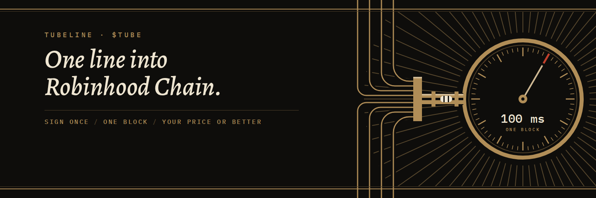
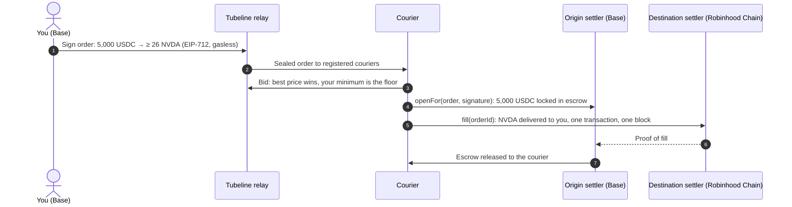
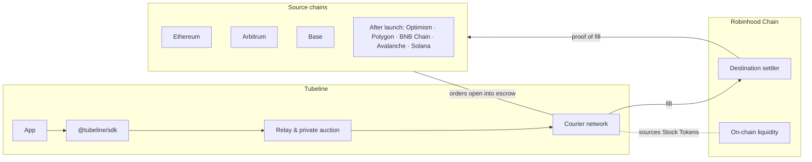

<p align="center">
  
</p>

<h1 align="center">Tubeline</h1>

<p align="center">
  <strong>One line into Robinhood Chain.</strong><br>
  Intent-based cross-chain settlement: sign one order on the chain your funds are on,<br>
  and a courier delivers it on Robinhood Chain, at your price or better.
</p>

<p align="center">
  <a href="https://tubeline.space"><strong>tubeline.space</strong></a> · <a href="https://x.com/tubedelivery"><strong>@tubedelivery</strong></a>
</p>

<p align="center">
  
  
  
  
  
</p>

---

## The problem

Stock Tokens trade on Robinhood Chain around the clock, long after the exchanges close. The money that wants them sits elsewhere: on Ethereum, Arbitrum, Base and a handful of other chains.

Getting from there to here today means bridging by hand. Approve, bridge, wait, switch networks, swap, and hope nobody trades ahead of you in the public mempool on the way. Several transactions, several fees, and minutes where your funds belong to no one.

## The answer

**Say what you want, not how to get it.**

```
5,000 USDC on Base  →  NVDA on Robinhood Chain,  at least 26 NVDA or nothing.
```

You sign that once. Couriers (solvers) compete to fill it. The winner delivers to you on Robinhood Chain from their own inventory, in a single transaction, and is repaid from your locked funds on Base only after the delivery is proven. If nobody fills it in time, the order expires and your funds never move.

## Four guarantees, enforced by contract

| | Guarantee | How it is enforced |
|---|---|---|
| **Your price** | You receive your signed minimum or better, or the order expires. | The minimum is inside your EIP-712 signature; the settlement contract will not accept a fill below it. |
| **Sealed** | Your order never touches a public mempool, so no one can trade ahead of it. | Signed orders go to registered couriers through a private auction. |
| **Proven** | A courier is paid only after your delivery is proven. | The origin settler releases escrow only against proof of the fill on Robinhood Chain. |
| **Nothing moves** | An unfilled order costs you nothing from Tubeline and leaves your funds where they were. | Gasless orders (Permit2) pull funds only when a courier opens the order to fill it. |

## How it works



Delivery on Robinhood Chain is one transaction in one 100 ms block, once a courier fills. That is the delivery leg only; how quickly an order is filled depends on the source chain and the market.

## Architecture



| Component | Where | What it does |
|---|---|---|
| Settlement contracts | [`contracts/`](contracts/) | ERC-7683 origin settlers (escrow, released only on proof) on each source chain, and the destination settler on Robinhood Chain. |
| SDK | [`packages/sdk/`](packages/sdk/) | `@tubeline/sdk`: build, sign and track orders in a few lines. Shared order types and EIP-712 definitions. |
| Relay | [`services/relay/`](services/relay/) | Receives signed orders, runs the sealed auction between couriers, serves quotes and order status. |
| Courier | [`services/courier/`](services/courier/) | The reference solver: quotes, fills on Robinhood Chain, claims repayment, rebalances inventory. |
| App | [`apps/web/`](apps/web/) | Order entry for everyone who doesn't write code. |
| Documentation | [`docs/`](docs/) | Architecture, order lifecycle, security model, roadmap, glossary. |

Read [`docs/ARCHITECTURE.md`](docs/ARCHITECTURE.md) for the full design and [`docs/ORDER-LIFECYCLE.md`](docs/ORDER-LIFECYCLE.md) for every state an order passes through.

## Built on open standards

- **[ERC-7683](https://eips.ethereum.org/EIPS/eip-7683)** cross-chain intents: Tubeline orders resolve to the standard `ResolvedCrossChainOrder`, so any ERC-7683 filler can read them.
- **[EIP-712](https://eips.ethereum.org/EIPS/eip-712)** typed signatures: you see exactly what you sign, minimum included.
- **[Permit2](https://github.com/Uniswap/permit2)** for gasless approvals: funds move only when an order is opened.
- **Robinhood Chain** (Arbitrum Orbit) as the one destination, with its 100 ms blocks.

## For developers

```ts
import { tubeline } from '@tubeline/sdk';

const order = await tubeline.order({
  from: { chain: 'base', token: 'USDC', amount: '5000' },
  to:   { token: 'NVDA', minOut: '26' },
});
await order.delivered();
```

The SDK publishes with its documentation. The order types and EIP-712 definitions it is built on are in [`packages/sdk/src/`](packages/sdk/src/) today, and match the contracts field for field.

## Roadmap

- [x] Protocol design: order format, settlement flow, security model
- [x] ERC-7683 interfaces and the Tubeline order type, in Solidity and TypeScript
- [ ] Settlement contracts: origin escrow and destination fill
- [ ] Relay and sealed auction
- [ ] Reference courier
- [ ] SDK release and documentation
- [ ] Robinhood Chain testnet
- [ ] External audit
- [ ] Mainnet, bug bounty open from launch
- [ ] Open courier network: outside solvers bring their own inventory

The full plan and what each milestone requires: [`docs/ROADMAP.md`](docs/ROADMAP.md).

## Security

The contracts are audited before mainnet, and a bug bounty opens at launch. The threat model is in [`docs/SECURITY-MODEL.md`](docs/SECURITY-MODEL.md). Report vulnerabilities privately as described in [`SECURITY.md`](SECURITY.md), never in a public issue.

## $TUBE

$TUBE is Tubeline's token on Robinhood Chain. The only valid contract address is the one published on [tubeline.space](https://tubeline.space) and by [@tubedelivery](https://x.com/tubedelivery) on X. Any other address, presale or airdrop claiming to be $TUBE is not ours.

## Repository

```
contracts/          Foundry: ERC-7683 interfaces, order types, settlement contracts
packages/sdk/       @tubeline/sdk (TypeScript)
services/relay/     order intake, sealed auction, quotes, status
services/courier/   reference solver
apps/web/           order entry app
docs/               architecture, order lifecycle, security model, roadmap, glossary
```

Setup, build and test instructions: [`CONTRIBUTING.md`](CONTRIBUTING.md).

---

<sub>Tubeline is independent and is not affiliated with, endorsed by or sponsored by Robinhood Markets, Inc. Robinhood, Robinhood Chain and Stock Tokens are its trademarks; other chain names belong to their owners and only identify networks. Stock Tokens are not available to US persons. Nothing in this repository is an offer of $TUBE or any other asset, or financial advice.</sub>
