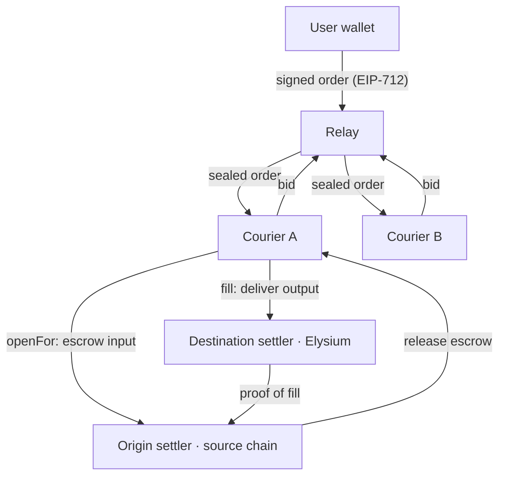

# Architecture

Tubeline moves value one way: from the chain a user's funds are on, into Elysium. A user states the outcome they want; a courier with inventory already on Elysium delivers it at once and is repaid from the user's escrow afterwards. The user never bridges, and never waits for a bridge.

## Design goals

1. **The user signs an outcome, not a route.** One EIP-712 signature names the input, the output token, the minimum accepted and the deadlines. Everything else is the courier's problem.
2. **Funds move only when delivery is committed.** Nothing leaves the user's wallet until a courier opens the order to fill it, and the courier is repaid only after the fill is proven.
3. **Standard, not bespoke.** Orders are ERC-7683, so any ERC-7683 filler can read and fill them, and Tubeline can plug into the wider intents ecosystem rather than compete with it.
4. **Delivery is a single Elysium transaction.** The courier fills from inventory already on the destination chain, so delivery lands in one block regardless of how slow the source chain is.

## Components

### Origin settler (each source chain)

Implements `IOriginSettler`. `openFor` verifies the user's signature over the `TubelineOrder`, checks `openDeadline` and the nonce, and pulls `inputAmount` of `inputToken` into escrow through Permit2. It emits the standard `Open` event with the `ResolvedCrossChainOrder`. Escrow is released to the courier on a valid proof of fill, or back to the user after `fillDeadline`.

### Destination settler (Elysium)

Implements `IDestinationSettler`. `fill` moves the output from the courier to the user's `recipient`, enforces `minOutputAmount` and `fillDeadline`, and records the fill once, for proof back to the origin chain.

### Relay and auction

Off-chain. Validates signed orders (signature, deadlines, balance, allowance), sends them sealed to registered couriers, and picks the best bid at or above the user's minimum. It never holds funds and cannot alter an order: the worst a faulty relay can do is fail to route one, which then expires with nothing moved. The settlers themselves are permissionless: any filler holding a valid signed order can open and fill it, so the relay routes orders but is never a gate on settlement.

### Couriers

Solvers holding inventory on Elysium. They price orders from on-chain liquidity, fill, claim repayment on the source chain and rebalance. Tubeline operates the first courier; the network is built for outside couriers to compete with their own capital.

## Proof of fill

The origin settler must learn, trust-minimised, that a given order was filled on Elysium at or above its minimum. Two designs are being evaluated behind one interface, so a route can use either:

| Design | How | Trade-off |
|---|---|---|
| Cross-chain messaging | The destination settler sends a message (via an established messaging layer) that the origin settler verifies. | Fast repayment; trusts the messaging layer's security model. |
| Optimistic | The courier claims repayment; anyone can dispute within a challenge window by proving no matching fill exists. | Minimal external trust; repayment waits for the window, which ties up courier capital longer. |

Repayment speed matters beyond the courier: the sooner a courier is repaid, the less capital it needs, and the tighter it can price.

## Solana

Solana has no EIP-712 or Permit2, so Solana orders use an escrow program: the user signs one transaction that locks the input, refundable if unfilled by the deadline. Delivery on Elysium and the courier's role are identical.

## Why Elysium only

Tubeline does one route and does it well: into Elysium, Kinetiq's L2 for Hyperliquid, which settles to HyperEVM and has no direct canonical bridge from Ethereum or the other source chains. A single destination means one destination settler, one liquidity venue for couriers to price against, and one place where delivery must be fast.
