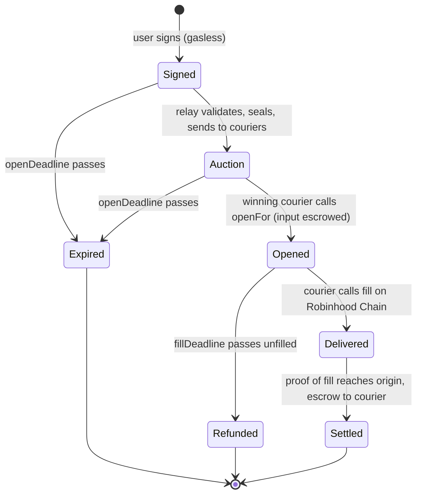

# Order lifecycle

| State | Where funds are | Moved there by | If it stalls |
|---|---|---|---|
| **Signed** | User's wallet | The user, signing off-chain | Expires at `openDeadline`. Nothing ever moved. |
| **Auction** | User's wallet | The relay | Expires at `openDeadline`. Nothing ever moved. |
| **Opened** | Origin settler escrow | The courier (`openFor`) | Refundable to the user after `fillDeadline`. |
| **Delivered** | Output with the user on Robinhood Chain; input still in escrow | The courier (`fill`) | The courier's claim waits for the proof; the user already has their output. |
| **Settled** | Input with the courier | The proof of fill | Final. |
| **Expired** | User's wallet, untouched | Time | Final. |
| **Refunded** | Back in the user's wallet | Anyone, after `fillDeadline` | Final. |

## Deadlines

- `openDeadline` bounds how long a signed order can sit unopened. Short: the price the user signed for goes stale.
- `fillDeadline` bounds how long an opened order can sit unfilled before the user can take their input back. It leaves room for the proof to arrive, so a courier who filled on time is always paid.

## The user's guarantees, by state

- Until **Opened**, the user's funds never leave their wallet.
- At **Delivered**, the user holds at least their signed minimum on Robinhood Chain.
- If an order never reaches **Delivered**, it ends **Expired** (nothing moved) or **Refunded** (input returned in full).
